# Ridge Pond: a dithered three.js scene

[](https://github.com/chasebuilds/dither-pond/actions/workflows/ci.yml)
[](https://chasebuilds.github.io/dither-pond/)

A farm pond in the hills, rendered with three.js and then passed through a full-screen dither shader. Pick what is in the scene (a jon boat, ducks, a heron, a deer, a cyclist, bats, fireflies, or nothing at all), mix them, and set the wind and the water. Drag the time of day from dawn to night: the sun angle, sky, water, fog and the light path on the water all blend as you go.

**Live demo: https://chasebuilds.github.io/dither-pond/**

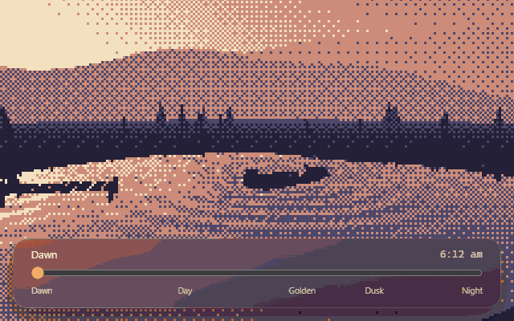

| Dawn | Day | Golden | Night |
|---|---|---|---|
| 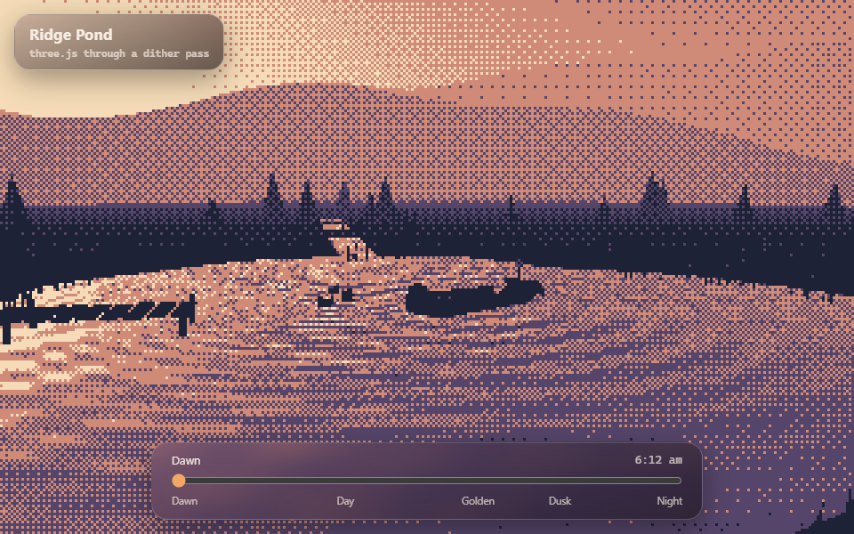 | 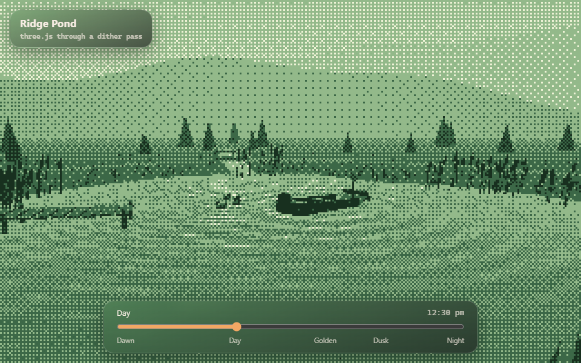 | 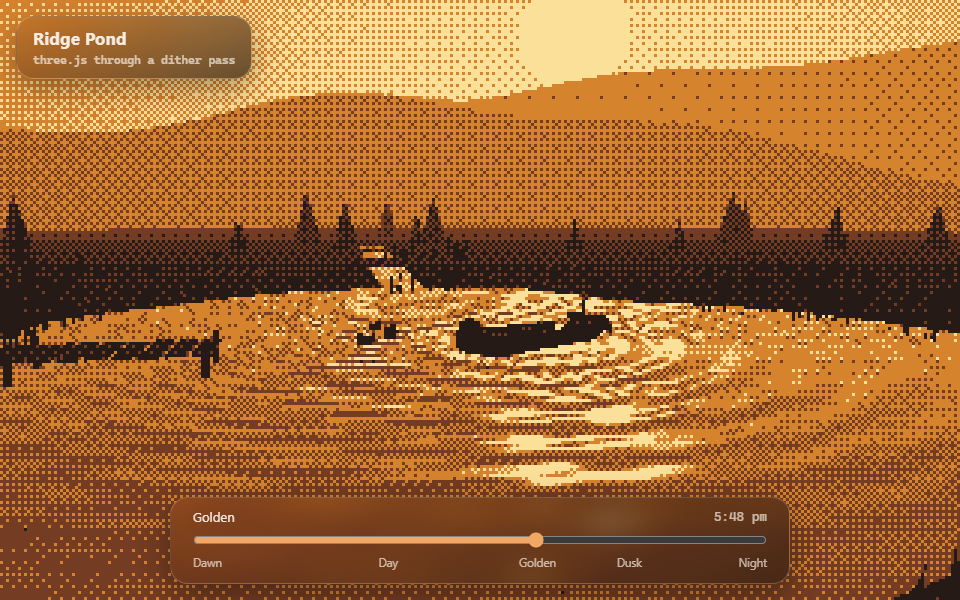 | 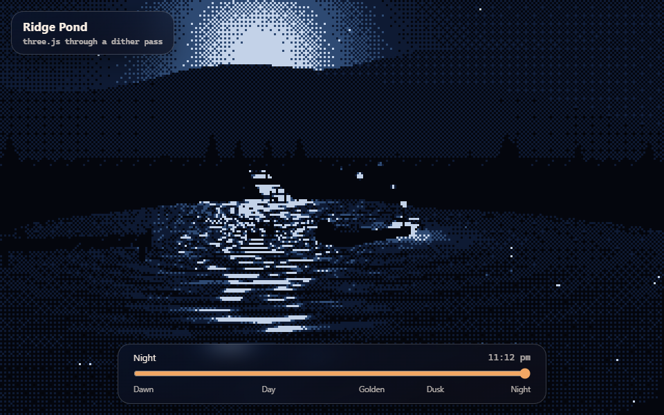 |

## Subjects

Every subject is built in code from three.js primitives (spheres, cylinders, boxes, cones). There are no model files, so there is nothing to license. Mix any of them.

| Jon boat | Ducks | Heron | Deer |
|---|---|---|---|
| 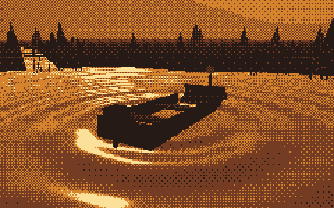 | 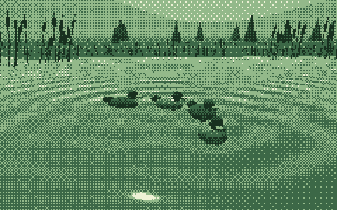 | 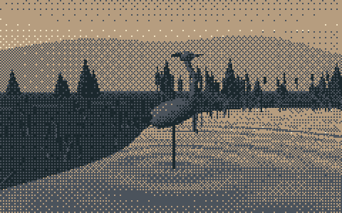 | 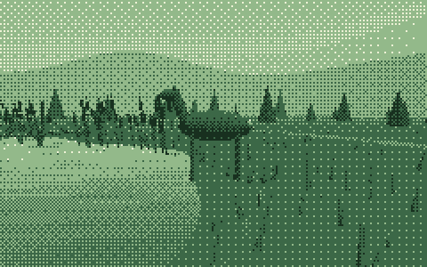 |
| Rocks with the wind and chop, sends out rings, lantern at night | Four ducks paddle a loop, each trailing small rings | Stands in the shallows and strikes at the water every 7 seconds | Looks around, then lowers its head and laps, rippling the edge |

| Cyclist | Bats | Fireflies | Empty, windy and choppy |
|---|---|---|---|
| 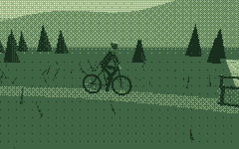 | 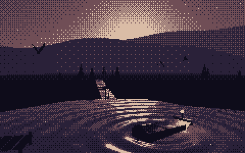 | 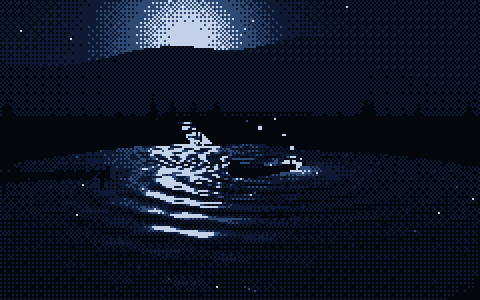 | 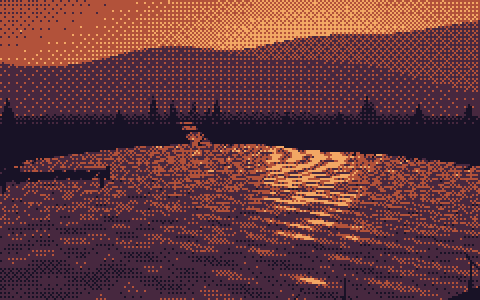 |
| Rides the road around the pond and over the creek bridge; wheels and pedals turn, legs solve to the pedals | Flap and loop over the water from dusk on | Blink over the banks at night and drift with the wind | No subjects, wind at full and water choppy |

## Controls

- **Time slider** along the bottom, or tap Dawn, Day, Golden, Dusk or Night. Arrow keys work on the slider.
- **Drag** to orbit (one finger on a phone). The camera stays above the water and slowly drifts until you touch it.
- **Tap the water** to drop a ripple. A fish rises every few seconds on its own.
- **Subjects:** tick any mix, or press Empty for only wind and water.
- **Wind:** bends the grass, cattails and trees, ruffles the water, pushes the ducks downwind and rocks the boat harder. It gusts around the level you set.
- **Water:** from glassy to rough. Adds short crossing waves and a slow swell, and makes everything floating bob and roll more.
- **Dither panel:** threshold map (Bayer 4x4, Bayer 8x8, blue noise, off), pixel size 1 to 8, and palette (4-tone ramp or RGB with 3 levels per channel).
- **Debug** button or the D key: frame rate, CPU time per frame, draw calls, triangles and the scene resolution.
- **Reduced motion:** if your system asks for reduced motion, the scene starts as a still frame (no ripples, drift or swaying). The Play motion button turns it back on.

## How the dither works

1. The 3D scene renders into a small off-screen target: the screen size divided by the pixel size. At pixel size 3 on a 1280 x 720 window that is 427 x 240.
2. A second pass draws one full-screen triangle pair. Each screen cell reads one texel of that small image, so the cells come out as crisp squares.
3. The cell also reads a threshold from a tiled map: its position modulo the map size picks one value between 0 and 1.
4. **Ramp palette:** the cell's brightness is scaled to the range 0 to 3 and split into a whole part and a fraction. The whole part picks one of four tones; the cell moves up to the next tone when the fraction is above the threshold. A 30% fraction turns on about 30% of the cells in any patch, which is what makes the gradients read as dot patterns.
5. **RGB palette:** the same test runs on red, green and blue separately with 3 levels each, so color survives.

The four tones come from the time of day (sage greens at noon, rust and amber at golden hour, plum at dusk, navy and moonlight at night), so the palette changes along with the light.

**Threshold maps:**

| Bayer 4x4 | Bayer 8x8 | Blue noise 64x64 | Off |
|---|---|---|---|
|  | 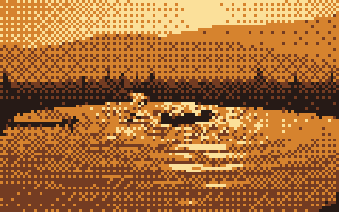 |  | 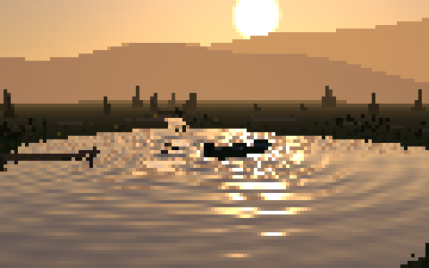 |

- **Bayer** matrices are built by the standard recursion. They give the regular cross-hatch look. 4x4 has 16 steps of gray, 8x8 has 64.
- **Blue noise** is generated in the browser by Ulichney's void-and-cluster method on a 64 x 64 torus (about 0.1 s, once). The dots look random but never clump. In the unit test, a 50% blue-noise pattern has 1.9% of the low-frequency energy of shuffled white noise.
- **Off** shows the low-resolution scene without dithering, for comparison.

## Measured

From [`docs/MEASURED.md`](docs/MEASURED.md), 1280 x 720, pixel size 3, motion on, default subjects (boat, ducks, fireflies):

| Setup | Frames per second |
|---|---:|
| RTX 5070, frame cap and vsync off | 3,800 to 4,600 |
| No GPU at all (SwiftShader software rendering on a Ryzen 5 7600X) | 38 |

The scene is 76 draw calls and about 16,600 triangles. Software-only rendering, with no GPU at all, still runs at 38 fps, so any phone or laptop with a working GPU should hold its display's refresh rate. The GPU number counts frame-loop passes with the frame cap off, not frames shown on screen. Rerun with `npm run measure`.

## Tests

`npm test` runs both suites; CI runs them on every push.

- **Unit (Node):** the Bayer 4x4 matrix matches the textbook values, Bayer 8x8 is a full permutation, blue noise is a full rank map and stays under 10% of white noise's low-frequency energy, threshold bytes are evenly spaced, every time-of-day key lands exactly, no step of the slider changes a color channel by 2% or more, the cyclist's thigh and shin keep their length through a full pedal turn, and the heron and deer head cycles hit their down and up poses.
- **Smoke (headless Chromium, SwiftShader):** loads the real page with three.js from the CDN. It checks that ramp mode puts 100% of pixels on four tones, night is darker than day, each threshold map changes the image, pixel size 6 gives exact 6 x 6 cells, RGB mode uses 3 levels per channel, each of the 7 subjects shows up on its own, mixing works and Empty clears them all, the wind and water sliders change the frame, the scene moves with motion on and is frozen under reduced motion, the debug panel shows a frame rate, and at 375 px phone width there is no sideways scroll and the controls work by touch.

## Run it

No build step. three.js r170 loads from a pinned jsDelivr URL in the import map in `index.html`.

```sh
npm install        # only Playwright, for the tests
npm run serve      # http://localhost:4173
npm test
npm run screenshots  # rebuilds docs/*.png and docs/sweep.gif (needs ffmpeg)
```

URL options for links and screenshots: `?t=0.76` (time, 0 to 1), `&subjects=boat,ducks,heron,deer,cyclist,bats,fireflies` (empty for none), `&wind=0..1`, `&chop=0..1`, `&mode=bayer4|bayer8|blue|off`, `&px=1..8`, `&palette=rgb`, `&still=1`, `&debug=1`, `&cam=x,y,z,targetX,targetY,targetZ`.

## Files

| File | What it does |
|---|---|
| `src/scene.js` | Builds the place: sky dome, three ridge layers, trees and grass that lean in the wind, pond and creek, road and plank bridge, dock, cattails |
| `src/subjects.js` | The pickable subjects: jon boat, ducks, heron, deer, cyclist, bats, fireflies |
| `src/motion.js` | Leg IK for the cyclist, head cycles for the heron and deer, wind gusts |
| `src/shaders.js` | Sky, water (rings from up to 6 floating or wading subjects, drops, wind ripples, chop, reflections, glint path, lantern pool), fireflies, and the dither pass |
| `src/dither.js` | Bayer and void-and-cluster blue-noise threshold maps |
| `src/time.js` | Five time-of-day keys and the smoothstep blend between them |
| `src/main.js` | Renderer, render target, UI, orbit controls, frame loop, debug stats |

Everything in the scene is procedural. There are no model or texture files.

MIT license. Built by Chase Builds.
